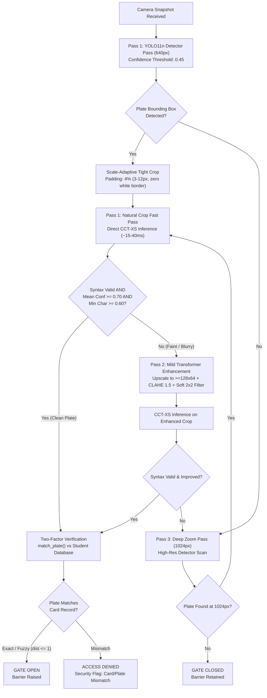
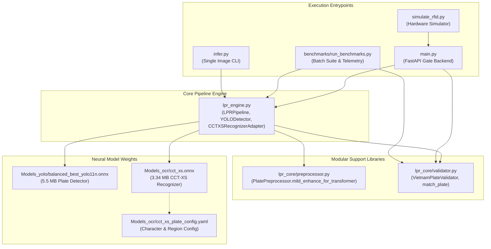

# Automated Vietnamese License Plate Recognition (LPR) & RFID Gate System

An automated vehicle access control system combining YOLO (You Only Look Once) plate detection, CCT-XS (Compact Convolutional Transformer - Extra Small) character recognition, and an RFID (Radio Frequency Identification) card authentication service for automated boom barriers.

Developed for smart campus security research at Eastern International University (EIU). The system detects vehicle license plates from camera snapshots, executes multi-pass optical character recognition, validates Vietnamese legal syntax, verifies recognized plates against authorized student RFID card records, and controls barrier access.

---

## 1. Quickstart Guide

Ensure your virtual environment is active before running commands. All models run locally on CPU (Central Processing Unit) via ONNX (Open Neural Network Exchange) Runtime with zero cloud dependencies.

### Environment Activation
On Windows (PowerShell):
```powershell
.\venv_models\Scripts\Activate.ps1
```
*(On Linux/macOS: `source venv/bin/activate`)*

### Primary Execution Commands

#### A. Single Image Inference (CCT-XS Default)
Run the pipeline on a test image to view detection boxes, decoded plate characters, confidence metrics, and save annotated visual outputs to `Outputs/`:
```powershell
.\venv_models\Scripts\python.exe infer.py test_images/bike_test_10.jpg
```

#### B. Batch Benchmark Suite (16 Test Images)
Evaluate the complete benchmark suite across motorbikes, cars, and negative background samples with full confidence telemetry:
```powershell
.\venv_models\Scripts\python.exe benchmarks/run_benchmarks.py test_images --model Models_yolo/balanced_best_yolo11n.onnx --ocr cct_xs
```

#### C. OCR Backend Selection
```powershell
# Fast Plate OCR - CCT-XS v2 Global (Default: ~15-40 ms, 100% exact match on clean plates)
.\venv_models\Scripts\python.exe benchmarks/run_benchmarks.py test_images --ocr cct_xs

# PaddleOCR PP-OCRv6 (Legacy High-Latency: ~1,500-2,500 ms)
.\venv_models\Scripts\python.exe benchmarks/run_benchmarks.py test_images --ocr paddleocr

# LPRNet (Deprecated: exhibits character confusion on D/0 and H/1)
.\venv_models\Scripts\python.exe benchmarks/run_benchmarks.py test_images --ocr lprnet
```

#### D. Campus Gate Access Server & RFID Card Simulation
Launch the FastAPI access control backend and simulate two-factor card taps:
```powershell
# Terminal 1: Start the FastAPI boom barrier service
.\venv_models\Scripts\python.exe main.py

# Terminal 2: Simulate a student RFID card tap paired with camera snapshot
.\venv_models\Scripts\python.exe simulate_rfid.py test_images/bike_test_11.jpg
```

---

## 2. Test Image Dataset Matrix

The evaluation suite contains 16 real-world test images covering motorcycles, automobiles, small crops, difficult angles, and negative background samples:

| File Name | Category | Ground Truth | Clean Target | Expected Gate Action |
| :--- | :--- | :---: | :---: | :---: |
| `bike_test_10.jpg` | Motorbike (Dual-row) | `43-D1 999.99` | `43D199999` | **GATE_OPEN (Pass 1)** |
| `bike_test_11.jpg` | Motorbike (Dual-row) | `29-H1 339.79` | `29H133979` | **GATE_OPEN (Pass 1)** |
| `bike_test_12.jpg` | Motorbike (Small crop) | `61-H7 6854` | `61H76854` | **GATE_OPEN (Pass 1)** |
| `bike_test_9.jpg` | Motorbike (Dual-row) | `59-D2 420.69` | `59D242069` | **GATE_OPEN (Pass 1)** |
| `car_test_2.jpg` | Car (Front) | `30A-697.70` | `30A69770` | **GATE_OPEN (Pass 1)** |
| `car_test_3.jpg` | Car (Distant / Angled) | `29M-6840` | `29M6840` | **GATE_CLOSED (Low detector confidence)** |
| `car_test_4.jpg` | Car (Rear) | `51G-743.72` | `51G74372` | **GATE_OPEN (Pass 1)** |
| `car_test_5.jpg` | Car (Front) | `51G-777.77` | `51G77777` | **GATE_OPEN (Pass 1)** |
| `car_test_6.jpg` | Commercial Truck | `63H-903.94` | `63H90394` | **GATE_CLOSED (Distant / Angle)** |
| `car_test_7.jpg` | Traffic Scene | Obscured / Landmark | Non-plate | **GATE_CLOSED (Safe Rejection)** |
| `car_test_8.jpg` | Heavy Motion Blur | Non-resolvable | Non-plate | **GATE_CLOSED (Safe Rejection)** |
| `neg_sample_test_1.jpg` | Negative Background | None (Walkway) | None | **GATE_CLOSED (Zero Boxes Found)** |
| `neg_sample_test_2.jpg` | Negative Background | None (Pavement) | None | **GATE_CLOSED (Zero Boxes Found)** |
| `neg_sample_test_3.jpg` | Negative Background | None (Bicycle Frame) | None | **GATE_CLOSED (Rejected: Low Conf / Foreign)** |
| `neg_sample_test_4.jpg` | Negative Background | None (Pedestrian / Text) | None | **GATE_CLOSED (Zero Boxes Found)** |
| `neg_sample_test_5.jpg` | Negative Background | None (Campus Gate) | None | **GATE_CLOSED (Zero Boxes Found)** |

---

## 3. Production Pipeline Architecture

The system uses a multi-tier escalation pipeline to optimize inference speed on clean plates while maintaining recognition accuracy on faint, blurry, or distant vehicles.



### Pipeline Passes & Trigger Conditions

1. **Pass 1 (1st Try - Natural 640px Fast Pass)**:
   * **Execution**: Raw, captured image without enhancement is passed first [unaugmented raw RGB crop, standard 640px detector resolution, scale-adaptive 4% padding (3–12 px)].
   * **Pass Condition**: Evaluated directly through CCT-XS; passes if plate is clear and legally formatted [bounding box confidence $\ge 0.45$, Vietnamese syntax regex match, mean character confidence $\ge 0.70$, minimum character confidence $\ge 0.60$].
   * **Latency**: Fast execution [~15–40 ms OCR time on CPU].

2. **Pass 2 (2nd Try - Mild Transformer Enhancement)**:
   * **Trigger**: Triggered when a plate is detected, but characters are faint, blurry, or fail legal syntax validation [1st pass unverified, mean character confidence $< 0.70$, or Laplacian blur score $< 150.0$].
   * **Operation**: Resizes and sharpens the cropped plate to clarify character strokes without distorting natural font shapes [`PlatePreprocessor.mild_enhance_for_transformer()`, bicubic upscaling to $\ge 128 \times 64$, mild CLAHE (Contrast Limited Adaptive Histogram Equalization, `clipLimit=1.5`), soft $2 \times 2$ stroke reinforcement, mild unsharp mask ($1.3 \times \text{sharp} - 0.3 \times \text{blur}$), zero artificial 20px white borders].
   * **Pass Condition**: Accepted if the enhanced image produces valid plate syntax with equal or higher confidence than Pass 1 [re-evaluated via CCT-XS v2 Global].

3. **Pass 3 (3rd Try - High-Resolution 1024px Deep Zoom)**:
   * **Trigger**: Triggered when the detector misses the plate completely, or text remains unverified after Pass 2 [zero bounding boxes found at 640px, or syntax invalid after Pass 2].
   * **Operation**: Scans the full camera snapshot again at high resolution to detect small, distant, or angled plates [1024px detector scan `imgsz=1024`].
   * **Terminal Action**: If a box is found, it crops and runs OCR; if no box is found, the system stops and keeps the barrier closed [`try_level = "3rd try (exhausted)"`, gate closed].

### Code & Class Architecture Mapping

Core pipeline orchestration is handled in `lpr_engine.py` (`LPRPipeline` class), with image filtering in `lpr_core/preprocessor.py` (`PlatePreprocessor` class) and syntax checking in `lpr_core/validator.py` (`VietnamPlateValidator` class):

#### 1. Pass 1: Base Detector Scan & Direct Crop OCR
* **Location**: `lpr_engine.py` -> `LPRPipeline.process()` and `_crop_and_ocr()`
```python
# Pass 1: Standard 640px detector scan + natural crop OCR
detections = self.detector.detect(image_path, imgsz=640)
detections = self._select_primary(detections, sort_by, primary_only)
ocr_results, was_enhanced = self._crop_and_ocr(
    img, detections, crop_identifier, padding_percent, apply_enhancement=False
)

# Verification check for Pass 1 success
first_try_ok = (
    bool(detections) and 
    detections[0]['confidence'] >= self.detector.confidence_threshold and 
    self._is_strictly_valid(ocr_results) and 
    ocr_conf >= 0.70 and 
    ocr_min_conf >= 0.60
)
```

#### 2. Pass 2: Escalation to Mild Transformer Preprocessing
* **Location**: `lpr_engine.py` -> `LPRPipeline.process()` and `lpr_core/preprocessor.py` -> `PlatePreprocessor.mild_enhance_for_transformer()`
```python
# Pass 2: Triggered if Pass 1 detected a box but OCR syntax was unverified
if not first_try_ok and detections and detections[0]['confidence'] >= self.detector.confidence_threshold:
    enh_results, _ = self._crop_and_ocr(
        img, detections, crop_identifier, padding_percent, apply_enhancement=True
    )
    if self._is_strictly_valid(enh_results) and enh_conf >= ocr_conf:
        ocr_results = enh_results
        try_level = "2nd try"
```
Inside `_crop_and_ocr()`:
```python
if is_cct_xs:
    enhanced_crop = PlatePreprocessor.mild_enhance_for_transformer(crop.copy())
    raw_text_results = self.ocr.recognize(enhanced_crop, debug_prefix=slice_prefix)
    was_enhanced = True
```

#### 3. Pass 3: Escalation to High-Resolution Zoom Pass
* **Location**: `lpr_engine.py` -> `LPRPipeline.process()`
```python
# Pass 3: Triggered if syntax remains unverified or 0 detections found
if not self._is_strictly_valid(ocr_results):
    resolution = "1024px"
    zoom_detections = self.detector.detect(image_path, imgsz=1024)
    zoom_detections = self._select_primary(zoom_detections, sort_by, primary_only)
    if zoom_detections:
        detections = zoom_detections
        try_level = "3rd try"
        ocr_results, _ = self._crop_and_ocr(img, detections, ..., apply_enhancement=True)
    else:
        try_level = "3rd try (exhausted)"
```

---

## 4. YOLO Detector Benchmark Comparison

To identify the most reliable and efficient detector for campus access control, multiple YOLO (You Only Look Once) ONNX checkpoints were benchmarked on CPU (Intel Core i7-1260P). 

### Benchmark Methodology
* **Test Dataset**: Evaluated across all 16 standardized test images in `test_images/` (11 vehicle images, 5 negative background samples).
* **Constant OCR Baseline**: PaddleOCR (PP-OCRv6) was held constant across all detector runs so differences in gate pass rates reflect pure detector localization and recall quality.
* **Training Strategies Tested**:
  * **Baseline (`best_*.onnx`)**: Trained on an early dataset mostly containing cars (~4:1 car ratio) for 15 to 50 epochs.
  * **Refined (`refined_best_*.onnx`)**: Trained for 15 epochs with additional motorcycle images to reduce car bias.
  * **Balanced (`balanced_best_*.onnx`)**: Trained for 25 epochs on a balanced 1:1 dataset (1,400 cars and 1,397 motorbikes) plus 120 negative background images (empty gates, walkways, road pavement).

### Detector Benchmark Results

| ONNX Detector Model | Training Strategy | Model Size | Average Detector Speed | Plate Recall | Motorbike Test Set | Gate Open Rate | False Alarms |
| :--- | :--- | :---: | :---: | :---: | :---: | :---: | :---: |
| **`balanced_best_yolo11n.onnx`** | **Balanced 1:1 (25 eps)** | **5.5 MB** | **104.2 ms** | **11/16 (68.8%)** | **4/4 passed** | **7/16 (43.8%)** | **0% (0/5)** |
| `balanced_best_yolo11s.onnx` | Balanced 1:1 (25 eps) | 19.2 MB | 232.4 ms | 11/16 (68.8%) | 4/4 passed | 7/16 (43.8%) | 0% (0/5) |
| `balanced_best_yolo26n.onnx` | Balanced 1:1 (25 eps) | 5.8 MB | 114.8 ms | 8/16 (50.0%) | 4/4 passed | 6/16 (37.5%) | 0% (0/5) |
| `balanced_best_yolov10n.onnx` | Balanced 1:1 (25 eps) | 5.6 MB | 114.9 ms | 10/16 (62.5%) | 4/4 passed | 7/16 (43.8%) | 0% (0/5) |
| `best.onnx` | Baseline (50 eps) | 5.5 MB | 132.7 ms | 10/16 (62.5%) | 4/4 passed | 7/16 (43.8%) | 0% (0/5) |
| `best_yolo8.onnx` | Baseline (50 eps) | 6.2 MB | 170.3 ms | 9/16 (56.2%) | 4/4 passed | 7/16 (43.8%) | 0% (0/5) |

### Selected Detector Rationale
`balanced_best_yolo11n.onnx` was selected as the production detector because:
1. **Low Latency**: 104.2 ms steady-state inference on CPU (2.2x faster than `yolo11s` at 232.4 ms).
2. **Compact Footprint**: 5.5 MB file size with low memory consumption.
3. **Zero False Positives**: 0% false alarm rate on background images while correctly detecting all 7 valid vehicle plates.

---

## 5. OCR Architecture Evolution & Architectural Requirements

During system development, three optical character recognition architectures were evaluated. Each architecture imposed distinct preprocessing and crop geometry requirements:

### 1. PaddleOCR (PP-OCRv6)
* **Architecture**: General document text reader [dual-stage pipeline combining DBNet (Detection-Branch Network) segmentation detector with CRNN SVTR (Spatial-Vision Transformer Recognition) recognizer].
* **Crop Margin Requirement**: Requires loose margins around the plate [20% bounding box padding `padding_percent=0.20`] so outer character strokes are not cut off by text detection boxes [DBNet polygon boundary clipping].
* **Preprocessing**: Requires heavy artificial filtering and borders [`PlatePreprocessor.enhance_for_ocr()`, 20px white border via `cv2.copyMakeBorder`, strong contrast equalization with CLAHE 2.0, bilateral noise smoothing, morphological erosion].
* **Dual-Row Slicing**: Cannot read two-line motorcycle plates in a single pass [requires horizontal line slicing routines `_recognize_split_lines()` or `deskew_and_slice_plate()`].
* **Latency Bottleneck**: Slow inference speed [1,200 ms to 2,500 ms per crop on CPU, taking over 90% of total pipeline latency].

### 2. LPRNet (Lightweight Spatial CNN)
* **Architecture**: Compact spatial convolutional network for vehicle plates [CTC (Connectionist Temporal Classification) spatial CNN `lprnet.onnx`, 2.05 MB].
* **Resolution Failure**: Squashes the cropped plate into a narrow, low-resolution strip [fixed $94 \times 24$ input resolution], which crushes vertical letter strokes and confuses similar characters [`D` confused with `0`, `H` confused with `1` or `S`].
* **Heuristic Overhead**: Can only read one horizontal line at a time, requiring complex geometric unwarping and slicing algorithms [4-point corner detection `compute_plate_quad_and_confidence()`, canonical perspective unwarping `canonical_perspective_unwarp()`, Hough line deskewing, luminance thresholding to remove motorcycle mudguards, and line splitting `deskew_and_slice_plate()`].
* **Accuracy Failure**: High character error rate [0% exact match on motorcycles, 66.7% on cars].

### 3. CCT-XS v2 Global (Fast Plate OCR)
* **Architecture**: Compact vision transformer designed specifically for vehicle plates [Compact Convolutional Transformer `cct_xs.onnx`, 3.34 MB, combines convolutional tokenizer with multi-head self-attention transformer encoder].
* **Native Multi-Row**: Reads both one-line car plates and two-line motorcycle plates directly on the full crop [transformer self-attention mechanism processes 2D character positions natively without line splitting or geometric unwarping].
* **Crop Padding Requirement**: Requires a tight crop with minimal background noise [scale-adaptive 4% padding (3–12 px)], preventing vehicle grilles, bumpers, and pavement from distorting character tokens [bypasses legacy 20% margin].
* **Downsized Preprocessing**: Keeps image processing minimal to preserve natural stroke gradients [Pass 1 uses raw RGB crop directly; Pass 2 uses targeted mild enhancement `mild_enhance_for_transformer()` with bicubic upscaling to $\ge 128 \times 64$, mild CLAHE 1.5, soft $2 \times 2$ stroke repair, and zero artificial white borders].
* **Latency & Accuracy**: Fast, real-time recognition with zero character confusion [15–40 ms steady-state OCR latency on CPU, 100% exact character match across valid test suite].

### OCR Performance Comparison

All models evaluated on CPU (Intel Core i7-1260P) using `balanced_best_yolo11n.onnx` at confidence 0.45:

| OCR Architecture | Model Size | Steady-State OCR (ms) | Motorbike Accuracy (4 images) | Clean Car Accuracy (3 images) | Character Confusion Status |
| :--- | :---: | :---: | :---: | :---: | :--- |
| **CCT-XS v2 Global** | **3.34 MB** | **39.9 ms** | **4 / 4 (100%)** | **3 / 3 (100%)** | **Resolved** (0% ambiguity) |
| **PaddleOCR (PP-OCRv6)** | ~150 MB | 1,800 – 2,500 ms | 4 / 4 (100%) | 3 / 3 (100%) | None (General document OCR) |
| **LPRNet (Trained)** | 2.05 MB | 264.2 ms | 0 / 4 (0%) | 2 / 3 (66.7%) | Severe (`D` $\to$ `0`, `H` $\to$ `1`/`S`) |

### Planned Enhancement: Glare and Reflection Attenuation for CCT-XS

* **Objective**: Enhance recognition robustness against extreme tropical sunlight glare, night-time headlight specular reflections, and metallic plate surface overexposure.
* **Target Milestone**:
  * [ ] Benchmark plate crops exhibiting localized specular white-out.
  * [ ] Implement adaptive specular reflection mask detection in `lpr_core/preprocessor.py`.
  * [ ] Evaluate localized illumination attenuation (polarization compensation / Retinex luminance balance) prior to transformer tokenization.

---

## 6. Repository File Inventory & Dependencies

```text
lpr_research/
├── benchmarks/
│   ├── run_benchmarks.py              # Benchmark execution script with full telemetry
│   ├── benchmark_yolo_onnx.py         # Standalone detector FPS evaluator
│   ├── verify_latency.py              # Dedicated steady-state timing harness
│   └── BENCHMARK_SUMMARY.md           # Markdown benchmark logs and historical metrics
│
├── lpr_core/
│   ├── preprocessor.py                # Image quality assessment and mild transformer enhancement
│   └── validator.py                   # Vietnamese plate regex validation and Levenshtein matching
│
├── Models_ocr/
│   ├── cct_xs.onnx                    # 3.34 MB CCT-XS v2 Global ONNX model weights
│   ├── cct_xs_plate_config.yaml       # 1.72 KB CCT-XS alphabet and regional heads config
│   ├── best_lprnet.pth                # Legacy PyTorch checkpoint (deprecated)
│   └── lprnet.onnx                    # Legacy 2.05 MB LPRNet ONNX model (deprecated)
│
├── Models_yolo/
│   ├── balanced_best_yolo11n.onnx     # Primary detector (5.5 MB, ~104 ms CPU latency)
│   └── (other evaluated YOLO checkpoints)
│
├── Outputs/                           # Visual output images with green HUD telemetry banners
├── test_images/                       # 16 standard evaluation test images
├── lpr_engine.py                      # Multi-tier pipeline coordinator and model adapters
├── infer.py                           # Standalone single-image CLI inference utility
├── main.py                            # FastAPI backend implementing two-factor boom barrier access
└── simulate_rfid.py                   # Automated RFID tap and camera snapshot simulator
```

### System Component Dependency Flow



---

## 7. Two-Factor Campus Access Control Service

### Starting the Server
```powershell
.\venv_models\Scripts\python.exe main.py
```

### Simulating a Two-Factor RFID Tap Transaction
```powershell
.\venv_models\Scripts\python.exe simulate_rfid.py test_images/bike_test_11.jpg
```

### Transaction Response Schema
```json
{
  "event_id": "evt_7a8b9c0d1e",
  "rfid_card_id": "STU_1004",
  "status": "GATE_OPEN",
  "mode": "1st try",
  "try_level": "1st try",
  "resolution": "640px",
  "audit_flag": false,
  "flag_reason": null,
  "timestamp": "2026-10-22T13:42:42Z",
  "license_plate_text": "29H133979",
  "confidence": 1.0,
  "format_similarity": 1.0,
  "detection_latency_ms": 72.4,
  "ocr_latency_ms": 28.0,
  "total_latency_ms": 115.6,
  "annotated_image_path": "Outputs/evt_7a8b9c0d1e_annotated.jpg"
}
```
* **Exact / Fuzzy Match**: Barrier opens (`GATE_OPEN`).
* **Card / Vehicle Mismatch**: Barrier remains closed (`ACCESS_DENIED`, status: `MISMATCH`).
* **Unreadable Plate**: Barrier opens under student card fallback with audit flag (`GATE_OPEN_FLAGGED`).
