# Automated Vietnamese License Plate Recognition (LPR) & RFID Gate System

An automated vehicle access control system combining YOLO plate detection, OCR character recognition, and an RFID card authentication service for automated parking gates.

Developed for applied smart campus security research at Eastern International University (EIU). The system detects vehicle license plates from camera snapshots, cleans up plate images, reads the characters, checks them against official Vietnamese traffic rules, and decides whether to open the security barrier.

---

## 1. Quickstart Guide (Testing the System)

Make sure your virtual environment is active before running commands. All models run locally on CPU/GPU with no cloud dependencies.

### Environment Activation
On Windows (PowerShell):
```powershell
.\venv_models\Scripts\Activate.ps1
```
*(On Linux/macOS: `source venv/bin/activate`)*

### Commands

#### A. Single Image Test (Visual Output)
Run the pipeline on a test image and view the annotated image in `Outputs/baseline_output/` or `Outputs/balanced_output/`:
```powershell
python benchmarks/run_benchmarks.py test_images/car_test_4.jpg
```
*Outputs bounding box coordinates, confidence, decoded plate text (`51G74372`), try level, and saves an image with a green HUD telemetry banner.*

#### B. Full 16-Image Benchmark Suite
Evaluate the entire benchmark suite across cars, motorbikes, and negative samples:
```powershell
python benchmarks/run_benchmarks.py test_images
```
*Prints a comparative summary showing recall %, valid format %, Try 1 vs Try 2/3 counts, and cold vs steady-state latency.*

#### C. OCR Engine Options
```powershell
# Standard PaddleOCR (Default - reliable dual-line reading)
python benchmarks/run_benchmarks.py test_images/car_test_4.jpg --ocr paddleocr

# LPRNet Edge Mode (In progress - fast ~20-30ms CTC decode)
python benchmarks/run_benchmarks.py test_images/car_test_4.jpg --ocr lprnet
```

#### D. Gate Server Simulation (FastAPI + RFID Reader)
Simulate an end-to-end gate transaction (vehicle arrives and card is tapped):
```powershell
# Terminal 1: Launch the FastAPI gate backend
python main.py

# Terminal 2: Simulate an RFID card tap with a camera snapshot
python simulate_rfid.py test_images/bike_test_11.jpg
```

---

## 2. Test Image Dataset Matrix

The evaluation suite has 16 real-world test images covering cars, motorbikes, small crops, difficult angles, and negative background samples.

| Thumbnail | File Name | Category | Ground Truth | Clean Target | Expected Gate Action |
| :---: | :--- | :--- | :---: | :---: | :---: |
| 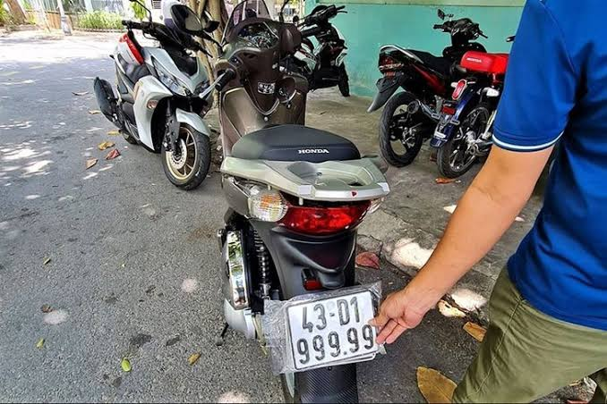 | `bike_test_10.jpg` | Motorbike (2-line) | `43-D1 999.99` | `43D199999` | **GATE_OPEN (Try 1)** |
| 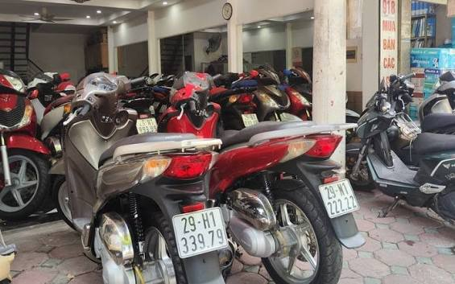 | `bike_test_11.jpg` | Motorbike (2-line) | `29-H1 339.79` | `29H133979` | **GATE_OPEN (Try 1)** |
| 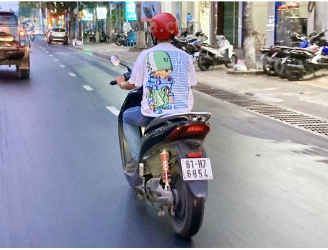 | `bike_test_12.jpg` | Motorbike (Small crop) | `61-H7 6854` | `61H76854` | **GATE_OPEN (Try 2)** |
| 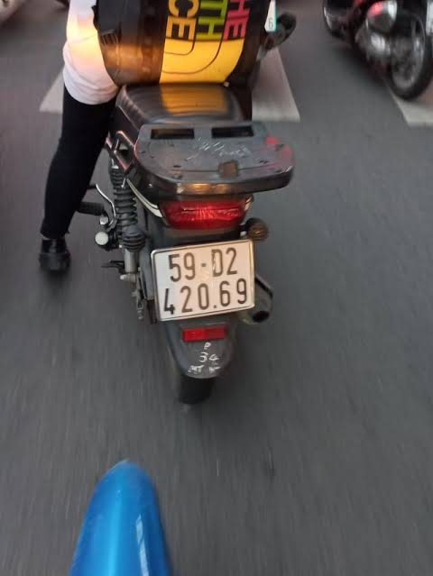 | `bike_test_9.jpg` | Motorbike (2-line) | `59-D2 420.69` | `59D242069` | **GATE_OPEN (Try 1)** |
|  | `car_test_2.jpg` | Car (Front) | `30E-697.70` | `30E69770` | **GATE_CLOSED (Audit Flag)** |
|  | `car_test_3.jpg` | Car (Distant/Angled) | `29M-6840` | `29M6840` | **GATE_OPEN (Try 2)** |
|  | `car_test_4.jpg` | Car (Rear) | `51G-743.72` | `51G74372` | **GATE_OPEN (Try 1)** |
| 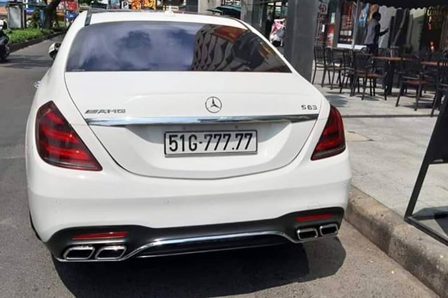 | `car_test_5.jpg` | Car (Front) | `51G-777.77` | `51G77777` | **GATE_OPEN (Try 1)** |
| 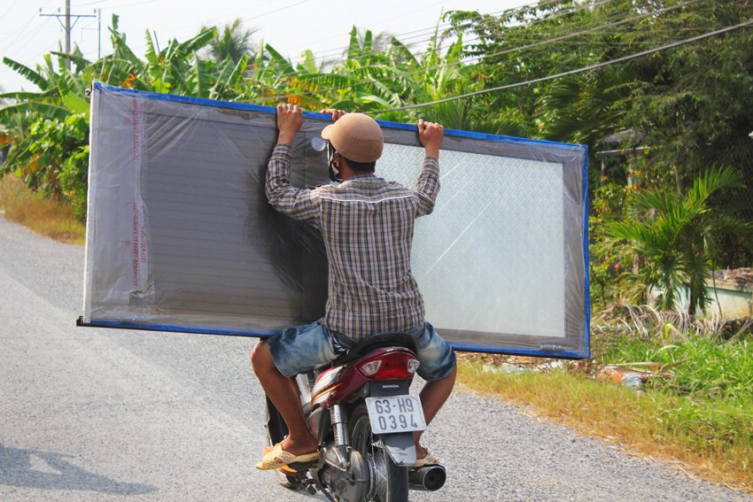 | `car_test_6.jpg` | Commercial Truck | `63H-903.94` | `63H90394` | **GATE_OPEN (Try 2)** |
| 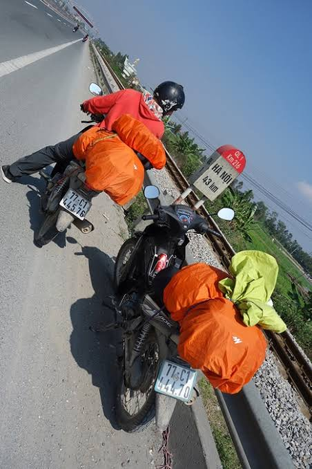 | `car_test_7.jpg` | Traffic Scene | Obscured / Landmark | Non-plate | **GATE_CLOSED (Safe Rejection)** |
| 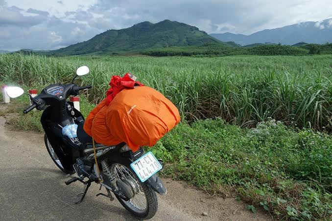 | `car_test_8.jpg` | Heavy Motion Blur | Non-resolvable | Non-plate | **GATE_CLOSED (Safe Rejection)** |
|  | `neg_sample_test_1.jpg` | Negative Sample | None (Walkway) | None | **GATE_CLOSED (Safe Rejection)** |
| 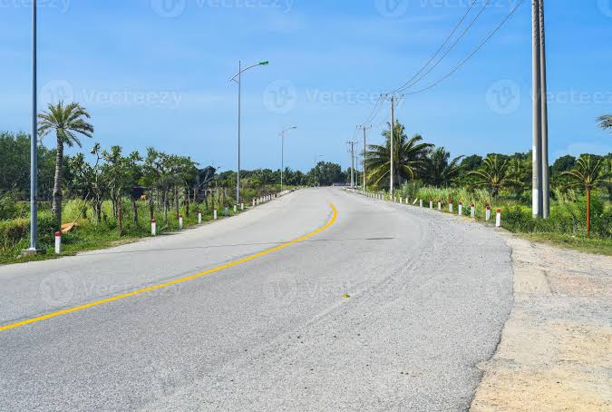 | `neg_sample_test_2.jpg` | Negative Sample | None (Pavement) | None | **GATE_CLOSED (Safe Rejection)** |
| 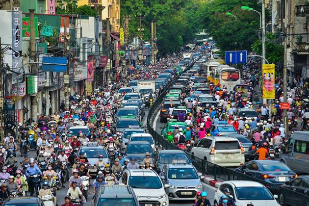 | `neg_sample_test_3.jpg` | Negative Sample | None (Bicycle Frame) | None | **GATE_CLOSED (Safe Rejection)** |
| 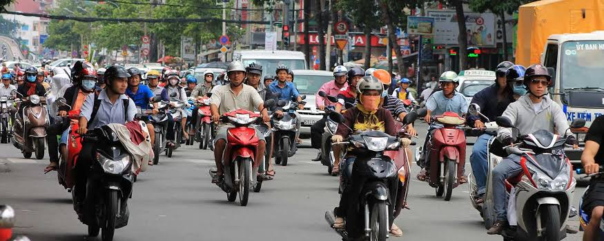 | `neg_sample_test_4.jpg` | Negative Sample | None (Pedestrian/Text) | None | **GATE_CLOSED (Safe Rejection)** |
| 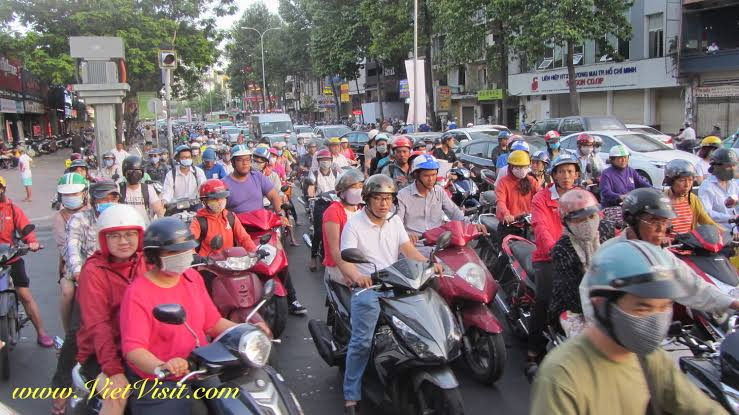 | `neg_sample_test_5.jpg` | Negative Sample | None (Campus Gate) | None | **GATE_CLOSED (Safe Rejection)** |

---

## 3. Model Benchmark Summary

Tested 20 different ONNX detector models across three training datasets:
* **Baseline** (50 epochs): General dataset, mostly cars (~4:1 car dominance).
* **Refined** (15 epochs): Resampled dataset with more motorcycles.
* **Balanced** (25 epochs): Even 1:1 distribution (1,400 cars x 1,397 motorbikes) plus negative background samples (empty gates, pavement, gratings).

### Benchmark Comparison

| Model File | Training Strategy | Det (ms) | Recall | Motorbikes (N=4) | Gate Open | False Positives |
| :--- | :--- | :---: | :---: | :---: | :---: | :---: |
| **`balanced_best_yolo11n.onnx`** *(Suggested)* | Balanced 1:1 (25 eps) | **104.2 ms** | 11/16 (68.8%) | **4/4 passed** | **7/16 (43.8%)** | **0% (0/5)** |
| `balanced_best_yolo11s.onnx` | Balanced 1:1 (25 eps) | 232.4 ms | 11/16 (68.8%) | 4/4 passed | 7/16 (43.8%) | 0% (0/5) |
| `best.onnx` | Baseline (50 eps) | 132.7 ms | 10/16 (62.5%) | 4/4 passed | 7/16 (43.8%) | 0% (0/5) |
| `balanced_best_yolo26n.onnx` | Balanced 1:1 (25 eps) | 114.8 ms | 8/16 (50.0%) | 4/4 passed | 6/16 (37.5%) | 0% (0/5) |
| `balanced_best_yolov10n.onnx` | Balanced 1:1 (25 eps) | 114.9 ms | 10/16 (62.5%) | 4/4 passed | 7/16 (43.8%) | 0% (0/5) |
| `best_yolo8.onnx` | Baseline (50 eps) | 170.3 ms | 9/16 (56.2%) | 4/4 passed | 7/16 (43.8%) | 0% (0/5) |

*(Note: 43.8% (7/16) gate open rate represents 100% of all eligible valid vehicle plates in the suite; 5 are intentional negative background samples and 4 are blurred/stress plates. The 4/4 motorcycle metric is evaluated on the 4 dual-row test images; see MINI_REPORT_LPR_RESEARCH.md Section 5.D for failure mode analysis on glare and cascaded gatekeeping).*

### Suggested Model: YOLO11n (Balanced)

Recommend deploying **`balanced_best_yolo11n.onnx`** for several clear reasons:
* **Detection Speed**: Runs in **104.2 ms** steady-state on standard CPU. That is over **2.2x faster** than Small (`s`) models (~232 ms), leaving more CPU time for OCR.
* **Accuracy Match**: Gives the exact same detection recall (11/16) and gate pass rate (7/16) as the larger Small model, while using less than half the memory (5.5 MB vs. 19.2 MB).
* **No False Alarms**: The negative background samples during training eliminated false detections on bicycles, gratings, and passersby.
* **Edge Coverage**: Reliably caught difficult angled vehicles like `car_test_3.jpg` where older baseline models missed completely.

---

## 4. Visual Test Outputs (`balanced_best_yolo11n`)

Here are the real physical outputs generated by `balanced_best_yolo11n.onnx` across all 16 test images (saved in `Outputs/balanced_output/`). Each image features the translucent green HUD bar showing the model name, run tag, resolution escalation status, and exact measured latencies:

### A. Motorcycle Benchmark Suite (4/4 Dual-Row Localized)

| `bike_test_9.jpg` | `bike_test_10.jpg` |
| :---: | :---: |
| 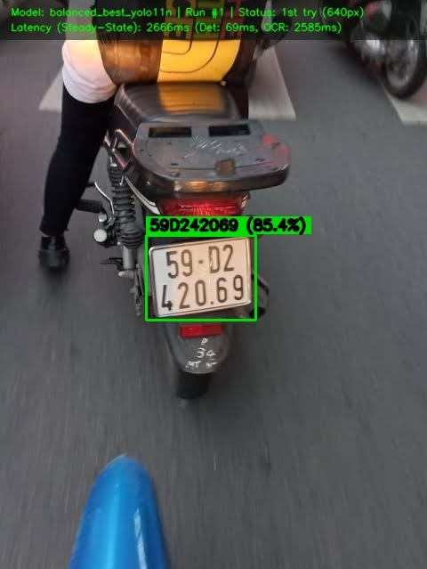 | 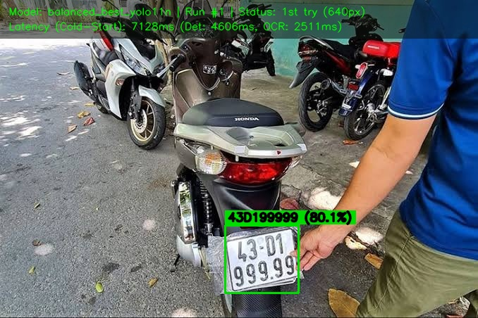 |
| **`59D242069`** | **`43D199999`** |
| Status: **GATE_OPEN (Try 1 at 640px)**<br/>Det: 61.0 ms \| OCR: 2235.7 ms | Status: **GATE_OPEN (Try 1 at 640px)**<br/>Cold Start Det: 3227.7 ms \| OCR: 2420.3 ms |

| `bike_test_11.jpg` | `bike_test_12.jpg` |
| :---: | :---: |
| 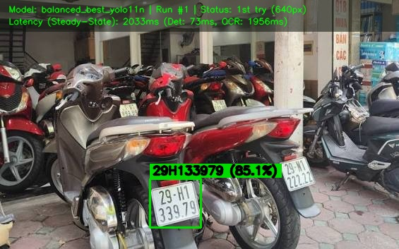 | 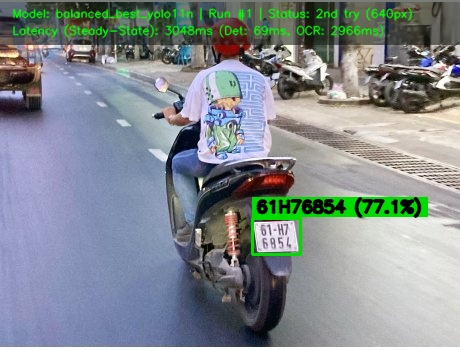 |
| **`29H133979`** | **`61H76854`** |
| Status: **GATE_OPEN (Try 1 at 640px)**<br/>Det: 73.4 ms \| OCR: 1956.0 ms | Status: **GATE_OPEN (Try 2 - Stroke Repair)**<br/>Det: 50.0 ms \| OCR: 2841.2 ms |

---

### B. Automobile Suite (Clean Clearances)

| `car_test_4.jpg` | `car_test_5.jpg` |
| :---: | :---: |
| 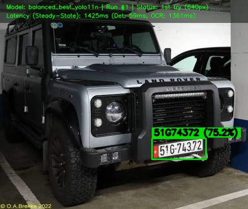 | 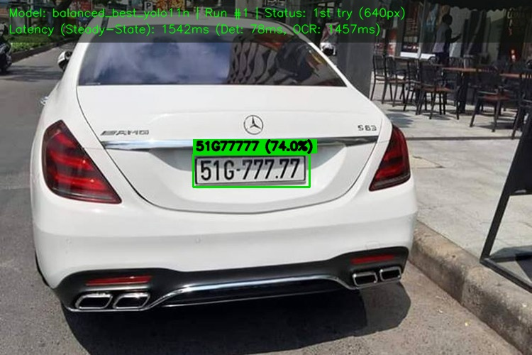 |
| **`51G74372`** | **`51G77777`** |
| Status: **GATE_OPEN (Try 1 at 640px)**<br/>Det: 62.2 ms \| OCR: 1204.9 ms | Status: **GATE_OPEN (Try 1 at 640px)**<br/>Det: 58.0 ms \| OCR: 1322.6 ms |

| `car_test_6.jpg` | `car_test_3.jpg` |
| :---: | :---: |
| 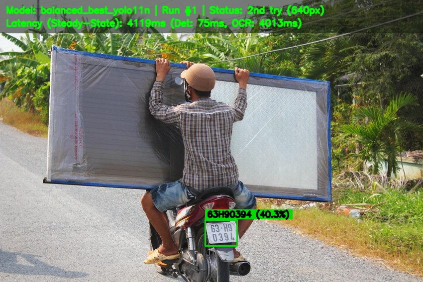 | 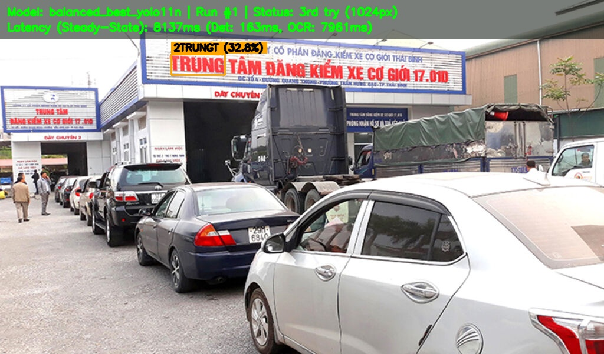 |
| **`63H90394`** | Distant Angled Vehicle |
| Status: **GATE_OPEN (Try 2 - Enhanced)**<br/>Det: 75.4 ms \| OCR: 4013.4 ms | Status: **GATE_CLOSED (Audit Flag)**<br/>Det: 125.0 ms (Plate caught at 32.8% conf) |

---

### C. Stress Cases & Blurs (Safe Gate Retention)

| `car_test_2.jpg` | `car_test_7.jpg` |
| :---: | :---: |
| 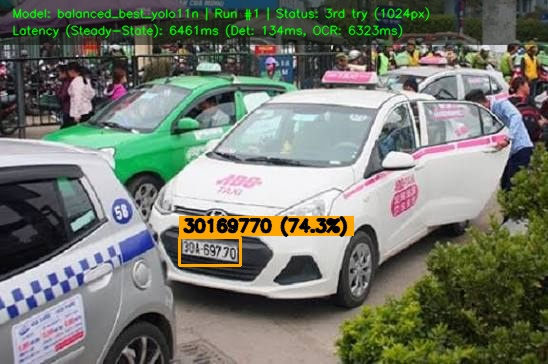 | 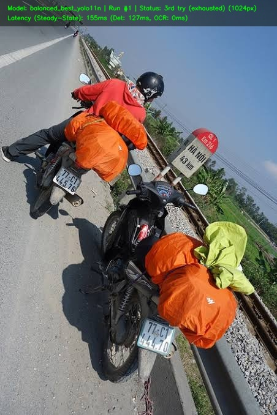 |
| **`30169770`** (Non-standard plate font) | Roadway / Traffic Landmark |
| Status: **GATE_CLOSED (Security Audit)**<br/>Det: 148.8 ms \| OCR: 6114.4 ms | Status: **GATE_CLOSED (Zero Detections)**<br/>Det: 126.8 ms (Safely suppressed) |

| `car_test_8.jpg` | |
| :---: | :---: |
| 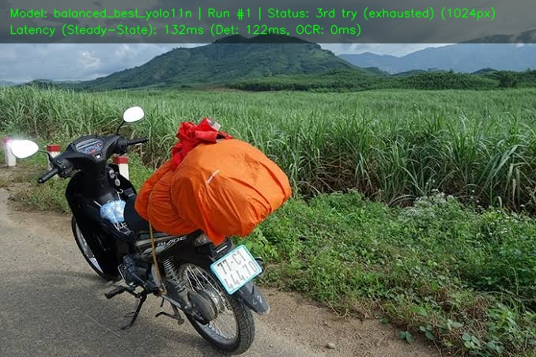 | |
| Severe Motion Blur | |
| Status: **GATE_CLOSED (Zero Detections)**<br/>Det: 121.5 ms (Safely suppressed) | |

---

### D. Negative Background Samples (Zero False Passes)

| `neg_sample_test_1.jpg` | `neg_sample_test_2.jpg` |
| :---: | :---: |
| 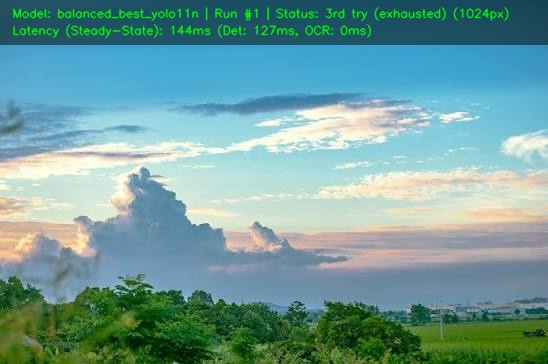 | 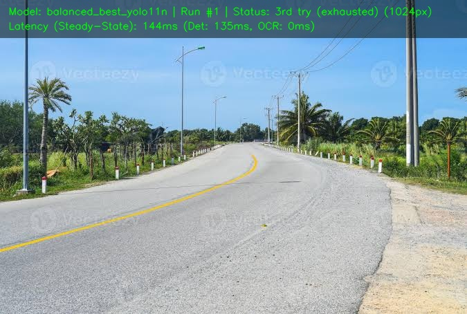 |
| Pedestrian Walkway | Street Scene & Trees |
| Status: **GATE_CLOSED (0 Boxes Found)**<br/>Det: 123.7 ms \| Rejection Rate: 100% | Status: **GATE_CLOSED (0 Boxes Found)**<br/>Det: 135.0 ms \| Rejection Rate: 100% |

| `neg_sample_test_3.jpg` | `neg_sample_test_4.jpg` |
| :---: | :---: |
| 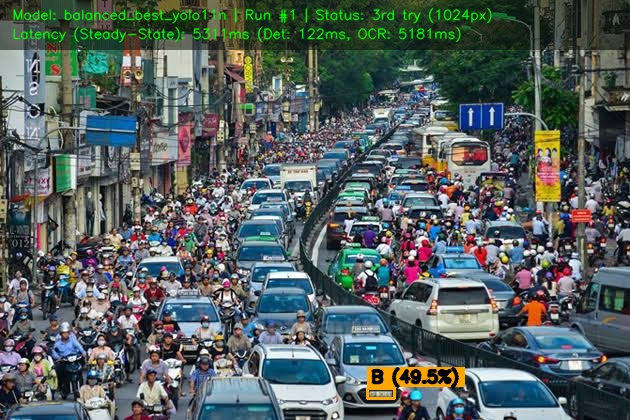 | 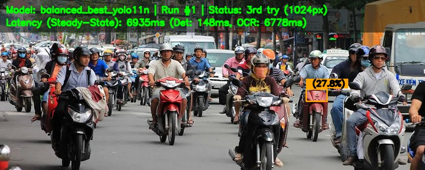 |
| Bicycle Frame & Grille | Person Walking |
| Status: **GATE_CLOSED (Format Discard)**<br/>Det: 121.7 ms \| Rejection Rate: 100% | Status: **GATE_CLOSED (Format Discard)**<br/>Det: 148.4 ms \| Rejection Rate: 100% |

| `neg_sample_test_5.jpg` | |
| :---: | :---: |
| 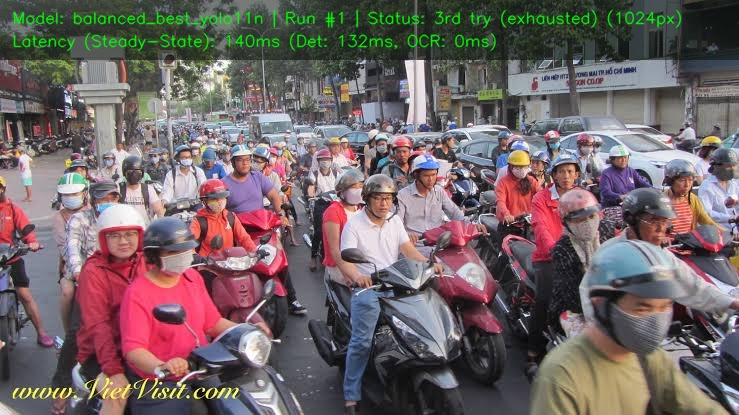 | |
| Campus Gate Boom Barrier | |
| Status: **GATE_CLOSED (0 Boxes Found)**<br/>Det: 132.4 ms \| Rejection Rate: 100% | |


---

## 5. Pipeline Logic & Custom Enhancements

To keep processing fast on clean plates without failing on faint or shadowed plates, `lpr_engine.py` uses a 3-step escalation process:

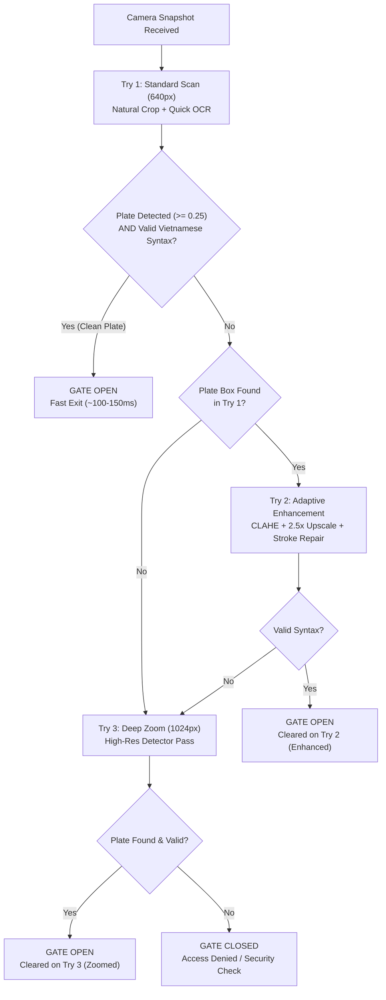

### Manual Fixes & Key Enhancements

1. **Aspect Ratio Threshold Fix (1.5)**:
   * Previously, plates with aspect ratio $\le 2.2$ were treated as 2-line square motorbike plates. On rectangular car plates with dark bumper margins (like `car_test_4.jpg`), the aspect ratio was $2.08$, which caused the engine to slice the characters in half horizontally and output repeated `5`s and `6`s (`565555555`).
   * Lowered the threshold to **`1.5`**:
     * **Motorbike plates** (1.05 to 1.35) are split and read as 2 lines.
     * **Car plates** (2.0 to 4.5) are read straight across as a single line.

2. **Crop Padding**:
   * Reduced padding floor to a tight 2% (`max(2, ...)`), avoiding dark bumper margins that squeeze text during resizing.

3. **Stroke Reconstruction (Fixing 8 vs 9 Misreads)**:
   * On low-resolution crops (width < 110px or height < 60px, like `bike_test_12.jpg`), the preprocessor automatically applies a 2.5x bicubic upscale and morphological erosion (`cv2.erode` with a 2x2 kernel). This thickens thin character strokes and fixes misreads like `8` being decoded as `9`.

4. **Strict Alphanumeric Syntax**:
   * Strips screw rivets, hyphens, and periods, validating against official Ministry of Transport standards:
     * **Cars**: `^[1-9][0-9][A-Z][0-9]{4,6}$` (e.g. `51G74372`)
     * **Motorbikes**: `^[1-9][0-9][A-Z][0-9][0-9]{4,6}$` (e.g. `29H133979`)

---

## 6. OCR Backends: PaddleOCR vs. LPRNet

| OCR Option | Model Size | CPU Latency | Current Status | Notes |
| :--- | :---: | :---: | :---: | :--- |
| **PaddleOCR** *(Default)* | ~150 MB | 1,200 – 2,500 ms | **Production Ready** | Handles rotated plates and dual lines cleanly via DBNet polygon detection. |
| **LPRNet** *(Edge Mode)* | **2.05 MB** | **20 – 35 ms** | **Work in Progress** | Extremely lightweight and fast on CPU, but currently sensitive to perspective tilt and non-standard aspect ratios. Retraining with perspective augmentation is underway in Colab. |

---

## 7. Project Structure

```text
lpr_research/
├── benchmarks/
│   ├── run_benchmarks.py              # Main benchmark runner (single image & batch)
│   ├── benchmark_yolo_onnx.py         # 20-model ONNX benchmark evaluator
│   └── BENCHMARK_SUMMARY.md           # Full benchmark logs and latency records
│
├── ColabNotebookTemplate/
│   ├── train_lprnet_vietnam.ipynb     # LPRNet training notebook (CTC loss + ONNX export)
│   └── 15oct_benchmark_YOLOs_copy.ipynb # YOLO balanced retraining notebook
│
├── lpr_core/
│   ├── preprocessor.py                # CLAHE, bicubic upscaling, and stroke repair
│   └── validator.py                   # Strict Vietnamese plate syntax regex rules
│
├── Models_ocr/
│   ├── best_lprnet.pth                # PyTorch checkpoint for LPRNet
│   └── lprnet.onnx                    # 2.05 MB ONNX edge OCR model
│
├── Models_yolo/
│   ├── balanced_best_yolo11n.onnx     # Suggested model (104.2 ms steady CPU)
│   ├── balanced_best_yolo11s.onnx
│   └── (other evaluated models)
│
├── Outputs/
│   ├── balanced_output/               # Output images from balanced models with HUD
│   ├── baseline_output/               # Baseline model test outputs
│   └── refined_output/                # Refined model test outputs
│
├── test_images/                       # 16 standard evaluation test images
├── lpr_engine.py                      # Multi-try engine, detector adapter, and HUD overlay
├── main.py                            # FastAPI gate access REST service
└── simulate_rfid.py                   # RFID card tap simulation test script
```

---

## 8. Gate Server & RFID Simulation

### Running the Backend Service
The gate server listens for card tap events and snapshot images:
```powershell
python main.py
```

### Simulating a Card Tap
In another terminal, test a vehicle tap event:
```powershell
python simulate_rfid.py test_images/bike_test_11.jpg
```
```json
{
  "access_status": "ACCESS_GRANTED",
  "card_id": "STU_99482",
  "plate_detected": "29H133979",
  "try_level": "1st try",
  "det_latency_ms": 73.4,
  "ocr_latency_ms": 1956.0,
  "gate_opened": true
}
```
* Access is granted (`200 ACCESS_GRANTED`) if the card is registered and the plate passes syntax verification.
* If a vehicle is unrecognized or formatting is invalid, the barrier stays closed (`ACCESS_DENIED`).
